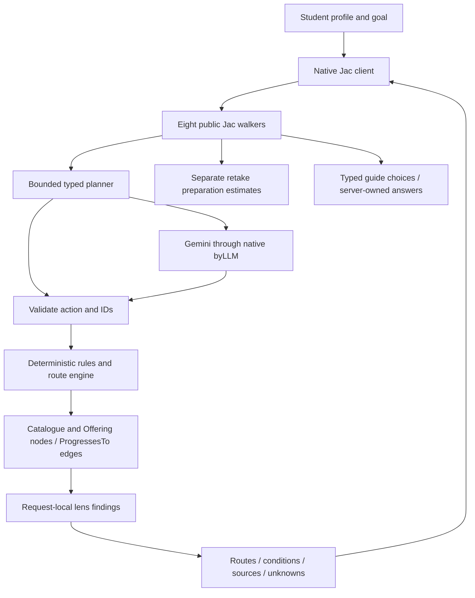

# UniPath LK
### Evidence-aware education pathways for Sri Lankan students · Built with Jac & byLLM

> AI Hackathon 2026 Sri Lanka · Working prototype across all fields of study

[](https://github.com/jaseci-labs/jac)
[](https://www.python.org/)
[](requirements.txt)
[](https://github.com/madukamalruk/unipathlk-v2/actions/workflows/verify.yml)

<picture>
  <source media="(prefers-color-scheme: dark)" srcset="assets/pathways-dark.png">
  
</picture>

## Executive summary

An A/L result should start a conversation about the next step. UniPath LK helps a student compare routes against interests, qualifications, available money and study preferences, including the possibility of another A/L sitting.

The researched discovery catalogue contains **37 real programmes, 12 fields and seven providers**. It includes university, higher-national-diploma and practical vocational options. The application shows up to three routes, their conditions, evidence and missing facts. It is a small prototype catalogue, not a national directory, an admission decision or a career guarantee.

**Current status:** runnable locally; 18 authored Jac modules check; 54 native tests and 11 HTTP groups pass. A real Gemini planning request returned `live_ai` in 3.67 seconds during the latest audit. JacHammer hosting and event submission are pending. See the [strict judge audit](docs/judge-audit-2026-10-17.md) for evidence and limitations.

## Key features

| Capability | What works today |
| --- | --- |
| All-field discovery | IT, engineering, health, science, business, law, social sciences, education, arts, languages, agriculture and hospitality. |
| Evidence-aware route planning | Direct and multi-stage graph search; node and transition requirements; pass/fail/unknown outcomes; stable route IDs. |
| Whole-route budgeting | Upfront payments, monthly contributions/expenses and extra initial savings needed, when complete inputs exist. Unknown costs remain unknown. |
| Practical student choices | DTET/SLITHM vocational offerings and a separate repeat-A/L preparation scenario with time, spending and income-forgone trade-offs. |
| Native Jac workspace | Profile, route comparison, conditions, sources, graph projection, actual planning events, light/dark themes and Colombo clock. |
| Optional study guide | Gemini selects allowlisted catalogue/tip IDs; the server supplies displayed facts and links. Curated fallback remains available. |
| Explicit stress scenario | Recompute travel +40% together with a six-month first-stage delay; show absolute deltas rather than a fabricated resilience percentage. |

Another examination sitting and eligibility for UGC internal admission are separate questions. Retake sources are labelled by their published year and scope; no future grade, Z-score probability or university place is predicted.

## How Jac and Jaseci are used

| Jac primitive | Actual implementation |
| --- | --- |
| `node` | `Catalogue` owns the immutable catalogue snapshot; `Offering` stores each programme record. [Engine](services/engine.jac#L12). |
| `edge` | `ProgressesTo` carries explicit progression requirements and evidence. [Loading](services/engine.jac#L22). |
| `walker` and `spawn` | `BranchSearchWalker` explores candidate paths with copied branch state; public API walkers invoke server operations. [Search](services/engine.jac#L290), [API](services/api.jac). |
| `visit` and `here` | `LensWalker` visits offering nodes and computes request-local findings at node entry. [Traversal](services/engine.jac#L350). |
| `by llm` and `sem` | Typed planner decisions and guide ID selections use native byLLM. [Planner](services/planner.jac#L25), [guide](services/assistant.jac#L21). |
| Native client components | `.cl.jac` components compile through Jac's client toolchain. There is no handwritten JavaScript recommendation engine. [Client](components/App.cl.jac). |

**The agentic boundary is deliberate.** The planner observes current state, proposes one supported action and dispatches real search/evaluation/clarification/finish operations. Outputs are validated before use. The first search and evaluation actions are mandatory; later discretion is limited to asking an allowed clarification, finishing and tie-breaking among checked routes. This is bounded orchestration, not unrestricted autonomous research or a debating council of LLM agents.

Three instances of `LensWalker` produce Aspiration, Fiscal and Gatekeeper findings. Bridge findings are derived from discovered multi-stage routes; **there is no separate Bridge walker**. Branch search uses a deterministic frontier over real graph edges, while the lens walker uses node-entry `visit`. There is no persistent student-agent memory or AI-created credit-transfer graph. Development-agent collaboration is separate from runtime product behaviour.

## Architecture



Shared catalogue nodes are read-only. Profiles, qualification sets, findings and planner state belong to a request; conversation display belongs to the browser session. Search is capped at four stages, 100 expanded states and 20 candidates. Planner work is capped at four actions and a 15-second session budget. Missing keys, invalid proposals, timeouts and provider failures use honest fallback labels.

## Data: real versus fictional

| Catalogue | Contents and interpretation |
| --- | --- |
| `real` — default | 37 researched programme records and **one** sourced English diploma-to-degree application edge. An application route does not assert automatic admission, credit exemptions or a shortened degree. |
| `demo` — explicit opt-in | Five fictional offerings and three transitions for hand-checkable numerical/graph examples. UI banners and source panels label fixtures. They are not real institutions or course prices. |

The real catalogue currently contains **309 claim records: 92 verified, 215 unreviewed and two stale**, with claim-level `source_url` and `checked_on`. A checked date records review, not an open intake. Complete real programme costs remain unknown for all 37 entries; published fee components do not establish a complete payment schedule. Unknown does not mean free. See [catalogue evidence](docs/catalogue-evidence.md) and [student-reality research](docs/student-reality-research.md).

The synthetic cash-flow oracle is clearly labelled: at savings LKR 2,000 and monthly contribution 5,000, the direct route costs **84,000 / initial gap 22,000**; the three-stage route costs **54,000 / gap 0**. These are validation fixtures, not advertised Sri Lankan fees.

## Quickstart and installation

Prerequisites: Git, **Python 3.12**, network access for pinned dependencies and the native client build. Tested runtime: Python 3.12.13, Jac 0.16.7, byLLM 0.6.19. Use the project environment; newer Jac syntax/runtime compatibility is not assumed.

### Windows PowerShell

```powershell
git clone https://github.com/madukamalruk/unipathlk-v2.git
cd unipathlk-v2
py -3.12 -m venv .venv
.venv\Scripts\python.exe -m pip install -r requirements.txt
$env:PYTHONIOENCODING = "utf-8"
.venv\Scripts\jac.exe start main.jac --port 8000
```

### Linux / macOS

```bash
git clone https://github.com/madukamalruk/unipathlk-v2.git
cd unipathlk-v2
python3.12 -m venv .venv
.venv/bin/python -m pip install -r requirements.txt
PYTHONIOENCODING=utf-8 .venv/bin/jac start main.jac --port 8000
```

Open [http://127.0.0.1:8000](http://127.0.0.1:8000). Windows launchers [run_project.ps1](run_project.ps1) / [run_project.bat](run_project.bat) use the local environment. `index.html` is a legacy startup note, not the application frontend.

### Optional Gemini configuration

Set `GOOGLE_API_KEY` or `GEMINI_API_KEY` in the **server environment** or an ignored local `.env`, using [.env.example](.env.example). `UNIPATH_MODEL` defaults to `gemini/gemini-3.5-flash-lite`; the model was accessible in the audit account, not guaranteed for every account. With no key, rule-based planning and curated guidance still run with explicit fallback labels.

Never put keys in frontend settings, commits, screenshots or demo recordings. Guide Gemini use requires its own opt-in. Questions can contain private information, so avoid personal identifiers.

## Verification and running tests

```powershell
$env:PYTHONIOENCODING = "utf-8"
.venv\Scripts\jac.exe --version
.venv\Scripts\jac.exe run main.jac
.venv\Scripts\jac.exe test -d tests -v
# With the server running:
.venv\Scripts\jac.exe run tests/http_regression.jac
.venv\Scripts\jac.exe run scripts/audit_source.jac
```

`jac run main.jac` checks the entry/import path; use `jac start` to serve the app. Linux/macOS use `.venv/bin/jac` for the equivalent commands. The [CI workflow](.github/workflows/verify.yml) checks every authored module, runs native tests and starts a clean API server for explicit HTTP checks.

Latest audit: **18 Jac modules passed; 54 native tests passed in 0.248s; 11 HTTP groups passed**. The HTTP file intentionally has no automatic test discovery; run its named main entry. Coverage includes cash-flow oracles, prerequisites on edges, cycles/caps, isolated requests, partial-grade validation, malformed/provider-failure outputs, known-ID validation, privacy bounds, retake estimates, endpoint/path/body restrictions and exact PNG delivery.

[Verified source CI — 2248e2a](https://github.com/madukamalruk/unipathlk-v2/actions/runs/39019439501). This proves those scoped checks, not complete browser, load, security or accessibility coverage. The owner supplied desktop/theme/panel screenshots; independent current browser control remains unavailable, so mobile/keyboard/focus interaction review is incomplete.

## Hackathon alignment and readiness

| Criterion | Evidence and remaining gap |
| --- | --- |
| Jac and Jaseci | Meaningful nodes, typed progression edges, walkers, node-entry traversal, native client and typed byLLM. Domain entities are represented within offering records rather than a larger typed graph ontology. |
| Agentic depth | Real bounded decisions and validated dispatch. Mandatory initial actions, one real progression edge and no autonomous research/council memory limit autonomy. |
| Technical execution | Local native build, 54 tests, 11 HTTP groups and clean Linux CI. JacHammer compatibility/live URL remain unverified. |
| Creativity and impact | Evidence-aware Sri Lankan pathway and repeat-A/L comparison across fields. Real-world outcome validation and catalogue breadth remain work. |
| Presentation | Current 150-second script and written description exist; older deck/video binaries require replacement or an explicit prior-release label. |

### The 80% Jac rule: measurement, not a guaranteed pass

| Handwritten-source scope | Nonblank line share | Nonwhitespace UTF-8 byte share |
| --- | --- | --- |
| All authored source, including tests/audit | 3,794 / 5,291 = **71.707% Jac** | 158,781 / 181,731 = **87.371% Jac** |
| Application/support source, excluding tests and audit script | 2,629 / 4,126 = **63.718% Jac** | 99,943 / 122,893 = **81.325% Jac** |

Generated code, dependencies, caches, JSON/lock files, documents and image bytes are excluded. CSS is included. There is no handwritten `.py` or `.js` application file; Python standard-library interop occurs inside Jac. Comments are included in these source measurements. The official PDF says at least 80% Jac but does not define a counting denominator. **Line-based counting currently fails; byte-based counting passes. Organiser clarification is required before claiming eligibility.** No minification, filler or Linguist overrides are used to manufacture compliance.

The official event PDF gives **17 October 2026, hacking from 09:00 and submission by 17:30 Asia/Colombo**; our owner targets **17:00** as a buffer. JacHammer hosting is encouraged, not mandatory in that PDF. Current commits have event-day timestamps, but commit dates alone do not prove the origin/timing of every received source file. Team check-in and final submission remain owner/event responsibilities.

## Deployment and demo

JacHammer import/deployment is the next optional delivery step after local review. Confirm the exact pinned runtime, native client and project compatibility hooks before deploying. Use host server-secret settings and smoke-test all eight operations. A successful local run does not prove hosted compatibility; keep the local/recorded fallback. See [JacHammer handoff](JACHAMMER_INIT_PROMPT.md).

- [Current 150-second demo script](DEMO_VIDEO_SCRIPT.md)
- [Written submission description](SUBMISSION_DOCUMENT.md)
- [Existing pitch PDF](docs/pitch-deck.pdf) / [PowerPoint](docs/pitch-deck.pptx)
- [Existing 150-second silent video](docs/demo-walkthrough.mp4) — **prior release**, not a recording of the current UI

No event submission or public app URL is claimed. Accounts, payments, saved plans, loan approvals, live scraping, guaranteed credit transfers and job guarantees are outside this prototype.

## Documentation suite

[PRD](prd.md) · [Architecture](architecture.md) · [Agent contracts](agents.md) · [Skills](skills.md) · [Decisions](decisions.md) · [Tasks](tasks.md) · [Memory](memory.md) · [Test matrix](docs/test-matrix.md) · [Release audit](docs/release-audit.md) · [Strict judge audit](docs/judge-audit-2026-10-17.md)

## Project

Built for AI Hackathon 2026 Sri Lanka. Repository: [madukamalruk/unipathlk-v2](https://github.com/madukamalruk/unipathlk-v2). The README organisation follows the owner's [AI-Hackathon-Trial](https://github.com/madukamalruk/AI-Hackathon-Trial) reference; product claims and measurements refer to this repository only.
